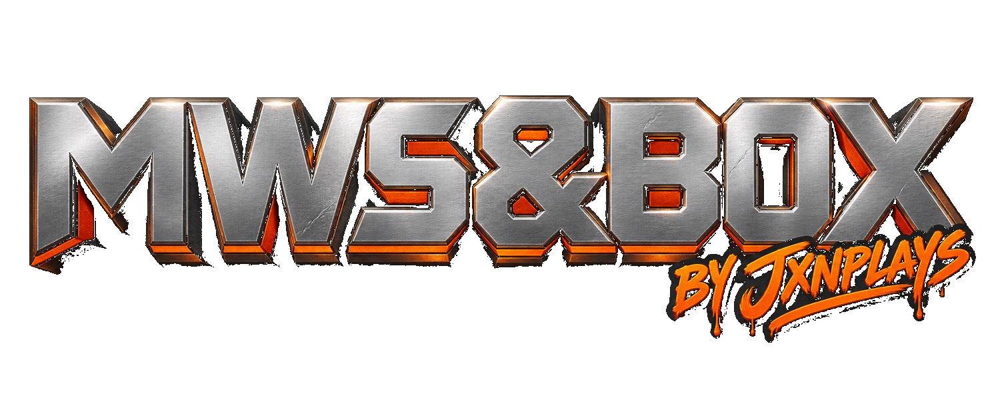

# MWS&BOX

[](LICENSE)
[]()
[](https://github.com/vladtrc/iw4L)

An IW4L-based sandbox client. Modern Warfare 2 is required. Additional Call of Duty titles are supported as optional DLC-style namespaces that read legitimate game installs you already own.

This repository contains the full upstream IW4L codebase plus project documentation. It does not contain or redistribute any game assets.

---

## Approach

Additional titles are treated as namespaces / DLC categories (the same way other titles sit behind their own family IDs in upstream). They do not fork the core render path. Each title contributes its own maps, weapons, attachments, and modes only when a reader and integration path exists.

**Required base:** Modern Warfare 2 (2009)

**Target titles (optional):**
- Call of Duty 3
- Call of Duty 4: Modern Warfare
- World at War
- Black Ops
- Modern Warfare 3
- Black Ops 2
- Advanced Warfare
- Call of Duty Online
- Black Ops 3
- Infinite Warfare
- Future Warfare (NX1)

Also includes mashup content from the IW4L mashup fork (Skate 3 and Minecraft) where applicable.


**Always build from source.** No prebuilt binaries are distributed. Clone this repository and follow the upstream IW4L build instructions. See [docs/BUILD-FROM-SOURCE.md](docs/BUILD-FROM-SOURCE.md).

---

## Building

This repo tracks the latest upstream [IW4L](https://github.com/vladtrc/iw4L). Follow the upstream build instructions in the original README sections below or in `docs/`.

You must supply your own legitimate game installs. Nothing in this repository replaces or includes game files.

To stay current with upstream:

```bash
git remote add upstream https://github.com/vladtrc/iw4L.git
git fetch upstream
git merge upstream/master
```


---

## DLC workflow

Each additional title is developed on its own branch (`dlc/nx1`, `dlc/bo2`, etc.) so work can land without risking the stable main branch. See [docs/DLC.md](docs/DLC.md).

## Progress

Per-title status lives in [`docs/progress/`](docs/progress/README.md).

### Research notes

- [`docs/findings/`](docs/findings/) — format notes and asset inventories (NX1, COD3, MW3)
- [`docs/resources/`](docs/resources/) — tool pointers and modding notes
- [`docs/notes/`](docs/notes/) — working notes on features and IW4L behavior

---

## Related projects

- [NX1 Reborn](https://github.com/jxnplays/NX1-Reborn) — maintained static recomp of Future Warfare
- COD3 Reborn — maintained recomp of Call of Duty 3 (in progress)
- CODOL Reborn — offline English version of Call of Duty Online (by Pteryla)

---

## Legal

This project is not affiliated with, endorsed by, or sponsored by Activision, Infinity Ward, Treyarch, Sledgehammer Games, Neversoft, or any other rights holder. All trademarks and copyrights remain the property of their respective owners.

You must legally obtain the games you wish to load. This repository contains only the client code, readers, and documentation. No game assets are included.

---

## License

Project documentation and local additions are MIT. See [LICENSE](LICENSE).

Upstream IW4L is Apache-2.0. See [NOTICE](NOTICE) and [THIRD-PARTY-LICENSES.txt](THIRD-PARTY-LICENSES.txt). Vendored components retain their original licenses.

---

*The remainder of this file is the original upstream IW4L README for build and usage details.*

---

# IW4L (upstream)

Standalone experimental Call of Duty runtime in Rust, built on Bevy and wgpu.

See the upstream repository for the latest build instructions, requirements, and controls: https://github.com/vladtrc/iw4L

